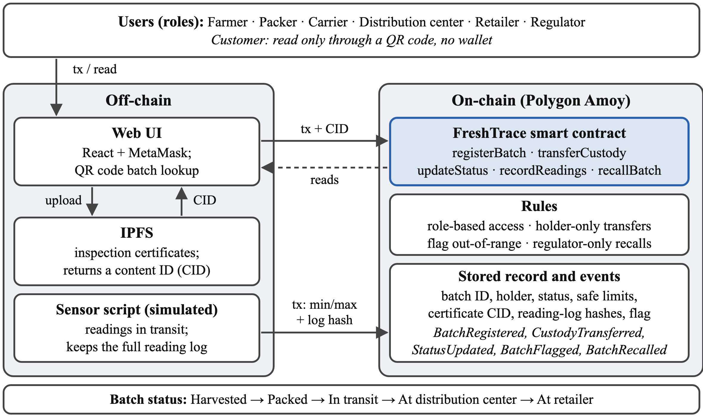

# FreshTrace

Team 22, CSE 540: Engineering Blockchain Applications (Fall B 2026)

Team members: Basavraj Chinagundi, Ashwanth Balakrishnan, Chitra Chowdary Joguparthi, Hemanth Reddy Gundepally, Vaibav Venkatapathy

## About

Fresh produce moves from a farm to a packer, carrier, distribution center and retailer, each keeping its own editable records. When a batch spoils or is contaminated, nobody can quickly prove where it came from, who held it, or whether it was kept in safe conditions. FreshTrace gives every party and the customer one tamper-proof record per batch.

FreshTrace tracks batches from farm to retailer through a React web UI, MetaMask and a role-based Solidity smart contract on the Polygon Amoy testnet.

- A farmer registers each batch, and it gets handed from one party to the next. Only the current holder can transfer it or update its status.
- When registering, the farmer sets a safe range for the sensor readings. A simulated sensor posts the min and max of each set of readings, plus a hash of the full log. If a reading is out of range, the batch is flagged and can't be transferred anymore.
- A regulator can recall any batch, which freezes it.
- Inspection certificates are stored on IPFS. Only the CID goes on-chain, so if someone changes a certificate it won't match.
- Customers scan a QR code to see the batch history. They don't need a wallet.

Physical sensor hardware and payments are out of scope. Sensor readings come from a simulated sensor script.



*Figure 1. FreshTrace architecture and batch lifecycle*

## Smart contract design

The contract is split into two files:

- `contracts/IFreshTrace.sol`: the interface, with the roles, statuses, structs, events, errors and function signatures
- `contracts/FreshTrace.sol`: the contract that implements it

Roles (one per wallet, set by the admin, who is the deployer): Farmer, Packer, Carrier, DistributionCenter, Retailer, Regulator, Sensor. Customers don't have a role.

Status only moves forward: Harvested → Packed → InTransit → AtDistributionCenter → AtRetailer

| Function | Who can call it | What it does |
|---|---|---|
| `setRole(account, role)` | Admin | Gives a wallet a role, or removes it with `Role.None` |
| `registerBatch(product, quantityKg, minLimit, maxLimit, certificateCID)` | Farmer | Creates a new batch |
| `transferCustody(batchId, to)` | Current holder | Passes the batch to a packer, carrier, distribution center or retailer |
| `updateStatus(batchId, newStatus)` | Current holder | Moves the batch to the next status |
| `recordReadings(batchId, minValue, maxValue, logHash)` | Sensor | Saves a reading summary, flags the batch if out of range |
| `recallBatch(batchId, reason)` | Regulator | Recalls the batch |
| `getBatch`, `getHistory`, `getReadings`, `roleOf`, `batchCount` | Anyone | Read functions for the customer page |

Flagged or recalled batches can't be transferred or updated. Readings and limits are stored as integers ×10, so 4.5 °C is stored as 45.

## Repository structure

```
contracts/   interface and main contract
test/        Hardhat tests
scripts/     deploy, role setup, sensor simulator, IPFS upload
frontend/    React web UI
docs/        architecture figure
```

## Dependencies

- Node.js 20 or 22 and npm
- Hardhat 2 with `@nomicfoundation/hardhat-toolbox` (includes ethers v6, Mocha/Chai and the gas reporter)
- Solidity 0.8.24 (Hardhat downloads it)
- dotenv
- MetaMask
- Test POL from the [Polygon faucet](https://faucet.polygon.technology) to deploy on Amoy
- A free [Pinata](https://pinata.cloud) account for IPFS uploads

## Setup

```bash
git clone https://github.com/raj-chinagundi/Team22_2026FallB_CSE540_FreshTrace.git
cd Team22_2026FallB_CSE540_FreshTrace
npm install
cp .env.example .env    # add your own test keys
npx hardhat compile
npx hardhat test
```

## Deploying

`deploy.js` writes the contract address and the ABI to `deployments/<network>.json`.
`setup-roles.js` reads that file, so always deploy before assigning roles.

Local chain:

```bash
npx hardhat node        # terminal 1
npm run deploy:local    # terminal 2
npm run roles:local
```

On a local chain the roles go to test accounts 1 to 7 (Farmer, Packer, Carrier, DistributionCenter,
Retailer, Regulator, Sensor). Account 0 is the admin and sends the `setRole` calls.

Polygon Amoy:

1. Put a test account's private key in `DEPLOYER_PRIVATE_KEY` in `.env` and fund it from the faucet.
2. Run `npm run deploy:amoy`. The deployer becomes the admin.
3. Fill in the team's wallet addresses in `AMOY_WALLETS` at the top of `scripts/setup-roles.js`,
   then run `npm run roles:amoy`. Any address still left as the zero address is skipped.

## How it's used

1. The admin assigns roles with `setRole`.
2. The farmer uploads the certificate to IPFS, then calls `registerBatch` with the CID and the safe range.
3. Each holder calls `transferCustody` and `updateStatus` as the batch moves along.
4. The sensor calls `recordReadings` during transit. Out-of-range readings flag the batch.
5. A regulator can call `recallBatch` at any point.
6. The customer scans the QR code, and the web page shows `getBatch`, `getHistory` and `getReadings`.

To see gas costs, run `REPORT_GAS=true npx hardhat test`.
